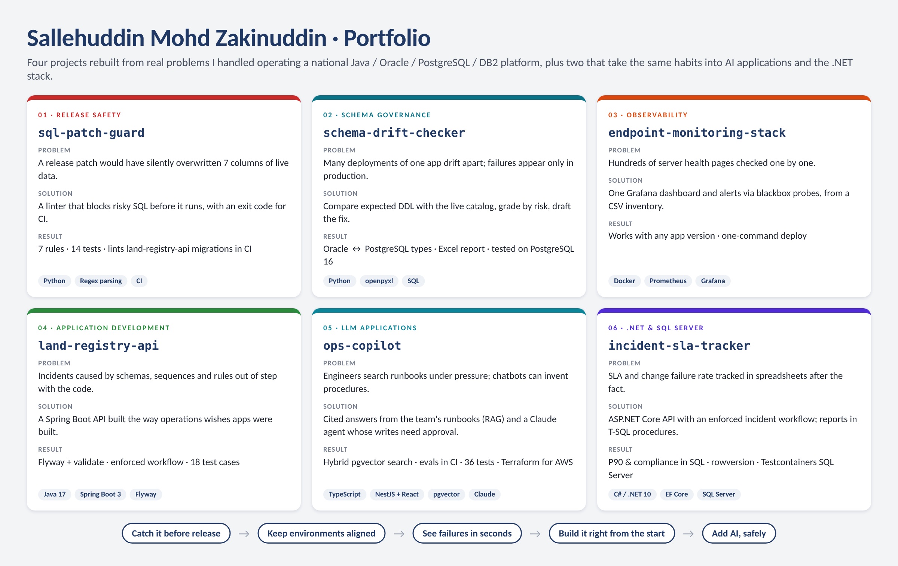

# Hi, I'm Sallehuddin

Senior Application Developer in the Operation Team at Protech Digital (Malaysia), supporting MyLAND and e-Tanah,
Java/Spring/Hibernate land administration systems used by state and federal government agencies. My day-to-day is
the part between code and production: Oracle, PostgreSQL and DB2 schema governance, releases, load testing,
disaster recovery drills, root-causing production issues, and turning manual checks into tooling.

**Stack:** Java · Spring Boot · JPA/Hibernate · Oracle · PostgreSQL · IBM DB2 · Python · Docker · Prometheus · Grafana · JMeter · Git · Linux

**Also building with:** TypeScript · NestJS · React · C# / .NET · SQL Server · LLM apps (RAG, tool-calling agents, Claude API) · AWS (Terraform)

## Projects

| Project | What it does | Built with | Docs |
|---|---|---|---|
| [sql-patch-guard](https://github.com/sllhddn/sql-patch-guard) | Lints database patch scripts for dangerous statements (silent column overwrites, unbounded DELETEs, Oracle sequence gotchas) before they reach production | Python, CI | [Usage](https://github.com/sllhddn/sql-patch-guard/blob/main/docs/USAGE.md) · [Design](https://github.com/sllhddn/sql-patch-guard/blob/main/docs/DESIGN.md) · [Poster](https://github.com/sllhddn/sql-patch-guard/blob/main/docs/poster.png) |
| [schema-drift-checker](https://github.com/sllhddn/schema-drift-checker) | Compares the schema the code expects with what is deployed, grades every difference, and writes an Excel report plus a draft fix script | Python, openpyxl, SQL | [Usage](https://github.com/sllhddn/schema-drift-checker/blob/main/docs/USAGE.md) · [Design](https://github.com/sllhddn/schema-drift-checker/blob/main/docs/DESIGN.md) · [Poster](https://github.com/sllhddn/schema-drift-checker/blob/main/docs/poster.png) |
| [endpoint-monitoring-stack](https://github.com/sllhddn/endpoint-monitoring-stack) | One Grafana dashboard and alert rules for hundreds of application servers, version-independent via blackbox_exporter | Docker Compose, Prometheus, Grafana | [Usage](https://github.com/sllhddn/endpoint-monitoring-stack/blob/main/docs/USAGE.md) · [Design](https://github.com/sllhddn/endpoint-monitoring-stack/blob/main/docs/DESIGN.md) · [Poster](https://github.com/sllhddn/endpoint-monitoring-stack/blob/main/docs/poster.png) |
| [land-registry-api](https://github.com/sllhddn/land-registry-api) | REST API for parcels and land dealing applications with a validated schema, enforced workflow and integration tests | Java 17, Spring Boot 3, JPA, Flyway, PostgreSQL | [Usage](https://github.com/sllhddn/land-registry-api/blob/main/docs/USAGE.md) · [Design](https://github.com/sllhddn/land-registry-api/blob/main/docs/DESIGN.md) · [Poster](https://github.com/sllhddn/land-registry-api/blob/main/docs/poster.png) |
| [ops-copilot](https://github.com/sllhddn/ops-copilot) | Runbook assistant: cited answers from the team's own documents (RAG), a Claude tool-calling agent, and human approval before any write; evals in CI | TypeScript, NestJS, React, PostgreSQL + pgvector, Claude API, Terraform (AWS) | [Usage](https://github.com/sllhddn/ops-copilot/blob/main/docs/USAGE.md) · [Design](https://github.com/sllhddn/ops-copilot/blob/main/docs/DESIGN.md) · [Poster](https://github.com/sllhddn/ops-copilot/blob/main/docs/poster.png) |
| [incident-sla-tracker](https://github.com/sllhddn/incident-sla-tracker) | Incident and release tracker: SLA deadlines, enforced workflow, SLA compliance and change failure rate computed in T-SQL | C#, .NET 10, ASP.NET Core, EF Core, SQL Server, Testcontainers | [Usage](https://github.com/sllhddn/incident-sla-tracker/blob/main/docs/USAGE.md) · [Design](https://github.com/sllhddn/incident-sla-tracker/blob/main/docs/DESIGN.md) · [Poster](https://github.com/sllhddn/incident-sla-tracker/blob/main/docs/poster.png) |

The first four start from real problems I handled at work, rebuilt generically with fictional data. The last two take the same habits into AI applications and the Microsoft stack.

## Currently learning

- Going deeper on C# / ASP.NET Core and SQL Server performance tuning
- React and TypeScript front ends
- LLM evaluation: paraphrase test sets, hosted embeddings, re-ranking

## Contact

[LinkedIn](https://www.linkedin.com/in/sllhddn/)
